  

### 🚀 Projelerimiz

  

### 🤝 Açık Kaynak Katkıları

Nova'yı geliştirirken kullandığımız kütüphanelerde karşılaştığımız sorunları kaynağında düzeltmeye çalışıyoruz.

<!-- KATKILAR:BASLA -->
| Proje | Katkı | Durum |
| --- | --- | --- |
| [simolus3/sqlite3.dart](https://github.com/simolus3/sqlite3.dart) | [Web'de veritabanı okumalarını dosya boyutundan bağımsız hâle getirme](https://github.com/simolus3/sqlite3.dart/pull/419) | 🟡 İnceleniyor |
| [akvelon/dart-highlighting](https://github.com/akvelon/dart-highlighting) | [Yalnızca kayıtlı dilleri derleyen `HighlightCore`](https://github.com/akvelon/dart-highlighting/pull/78) | 🟡 İnceleniyor |
<!-- KATKILAR:BITIR -->

<h3 align="center">Beraber büyüyelim. 🌱</h3>

  Aklınızdaki projeyi anlatın, sektörünüze uygun çözümü birlikte tasarlayalım. 
  İlk görüşme de, ilk çay da bizden. ☕

  
  
  

